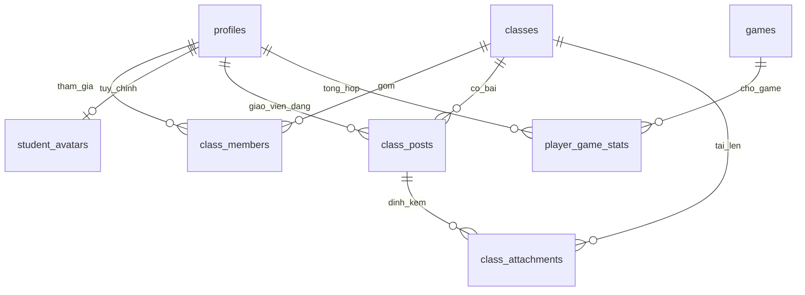

# Cấu trúc và bảo trì TIPY STEM

## Ranh giới trách nhiệm

| Vị trí                              | Trách nhiệm                                                     |
| ----------------------------------- | --------------------------------------------------------------- |
| `src/App.jsx`                       | Shell, nav, tài khoản hiện tại, cấu hình riêng cho lượt chơi    |
| `src/features/typing/`              | Thiết lập và giao diện game; logic thuần ở `src/game/engine.js` |
| `src/features/classroom/`           | Lớp học, quản lý thành viên, nhân vật và bài đăng               |
| `src/components/`                   | Dialog tài khoản, bảng kết quả, loading, âm thanh dùng chung    |
| `src/shared/Reveal.jsx`             | IntersectionObserver chạy một lần và disconnect                 |
| `src/screens/`                      | Trang chủ và trang admin                                        |
| `src/styles/`                       | CSS loader/lớp học; CSS chung ở `src/index.css`                 |
| `api/tipy.js`                       | HTTP, cookie phiên, origin, giới hạn body và phân phối action   |
| `server/backend.js`                 | Ghép các service với một Supabase client chỉ có ở server        |
| `server/modules/identity.js`        | Đăng ký/đăng nhập, HMAC PIN ngắn, phiên và kiểm tra hồ sơ       |
| `server/modules/games.js`           | Game, top, thống kê học sinh và kết quả giới hạn dung lượng     |
| `server/modules/game-validation.js` | Quy tắc điểm, thời gian, trạng thái và cấu hình                 |
| `server/modules/classrooms.js`      | Kiểm tra thành viên, CRUD mềm và ký URL Storage                 |
| `db/`                               | Schema PostgreSQL, migration cộng thêm, RLS và RPC transaction  |

Comment giải thích ranh giới, điều kiện an toàn hoặc lý do thiết kế. Tên hàm và cách chia module diễn tả thao tác; không thêm comment lặp lại từng dòng code.

## Mô hình dữ liệu

- `class_members` có khóa ghép `(class_id,user_id)`; tránh thành viên trùng và cho phép một học sinh tham gia nhiều lớp. Tên lớp không sao chép vào hồ sơ.
- `classes.archived_at` dùng xóa mềm/khôi phục. Các liên kết, thành viên, bài và file được giữ nguyên. `class_members.is_active` bỏ/khôi phục thành viên.
- `student_avatars` có một hàng/tài khoản; chỉ chấp nhận 12 con giáp Việt Nam và tập phụ kiện/màu cố định. API chỉ cập nhật tài khoản của phiên đăng nhập.
- Bài viết lưu text thuần, link HTTP(S); React escape nội dung. Tệp lưu trong bucket riêng, metadata ở bảng liên kết; không lưu base64 trong database.
- RPC `tipy_publish_post` kiểm tra admin, lớp, file đã có trong Storage và ghi bài + liên kết file trong một transaction.

## Quyền truy cập

| Thao tác                          | Khách | Học sinh                 | Admin               |
| --------------------------------- | ----- | ------------------------ | ------------------- |
| Luyện gõ thử                      | Có    | Có                       | Có                  |
| Lưu kết quả, xem top              | Không | Có                       | Có                  |
| Xem lớp/bài/thành viên/file       | Không | Chỉ lớp được thêm        | Tất cả lớp đang mở  |
| Đổi nhân vật                      | Không | Chỉ của mình, khi có lớp | API hỗ trợ của mình |
| Tạo/đổi tên/lưu trữ/khôi phục lớp | Không | Không                    | Có                  |
| Thêm/bỏ thành viên, gửi/gỡ bài    | Không | Không                    | Có                  |

Backend kiểm tra role từ DB và membership trước khi phục vụ dữ liệu hoặc ký URL. RLS và quyền RPC là lớp chặn độc lập; không dựa vào nút disabled ở giao diện. Không cấp quyền sửa bảng trực tiếp cho authenticated/anon. Server key không đi vào bundle.

File: tối đa 3 tệp/bài, 5 MB/tệp; PNG/JPG/WEBP/PDF/TXT/DOCX/XLSX/PPTX. Bucket private. URL tải xuống có hạn 5 phút; URL đã cấp có thể dùng tới khi hết hạn dù sau đó tài khoản bị bỏ khỏi lớp. Upload đi thẳng tới Storage qua URL có phạm vi một file; không qua giới hạn body 16 KB của API. File tải dở/chưa gắn bài không hiển thị với học sinh; cần kiểm tra định kỳ để dọn các upload admin bỏ dở nếu có.

## Tài nguyên và giới hạn

- Chỉ mount màn hình đang mở; game hủy requestAnimationFrame/listener khi rời màn hình.
- Reveal chạy một lần, disconnect observer; không có listener cuộn liên tục. Tôn trọng `prefers-reduced-motion`. Hiện dần là hiệu ứng giao diện, không tự làm giảm chi phí truy vấn.
- Bài tải 20/lần với nút xem thêm; ảnh chỉ tải khi mở file và dùng lazy decoding. CSS `content-visibility` giúp bỏ qua render bài ngoài vùng xem.
- Danh sách lớp tối đa 200, danh sách quản lý học sinh 200, sơ đồ lớp 300. Khi trung tâm vượt các mức này, bổ sung phân trang/tìm kiếm trước khi mở rộng.
- Kết quả game vẫn một hàng tổng hợp/người/game, tối đa best+latest; tổng thời gian không mất khi thay kết quả.
- Dữ liệu khóa và quan hệ có chỉ mục phục vụ membership và feed. Bảng lớp không có polling tự động; tải lại trang để nhận phân lớp mới từ admin.

## Quy trình sửa đổi

1. Chạy `npm ci` khi cài mới. Không đưa `.env*` hoặc service key vào Git.
2. `npm run format` để định dạng; `npm run format:check` để kiểm tra.
3. `npm run build` rồi `npm test`. Test UI dùng bundle vừa build, cần giữ thứ tự này.
4. Với schema mới, chạy lần lượt `db/schema.sql`, `db/compact_results.sql`, `db/classrooms.sql`. Migration lớp đã kiểm thử chạy lặp không mất dữ liệu.
5. Test RLS, quyền endpoint, dữ liệu và UI trước khi push. Vercel cũng chạy build + test trước khi phát hành.

Chỉ xóa vĩnh viễn bản ghi/file sau một quy trình dọn có rà soát; nút xóa lớp thông thường chỉ lưu trữ.

## Trang chủ giới thiệu và kho game

`src/screens/HomePage.jsx` giới thiệu Typing, Scratch, lớp học và địa chỉ TIPY STEM Cẩm Lệ. Không mount bảng top hoặc danh sách trò chơi trên trang này.

`src/screens/GameLibrary.jsx` nằm tại `#typing`, đọc catalog game đang mở từ API; chọn Chữ rơi chuyển tới `#typing/setup`. Game chưa có client engine sẽ hiển thị trạng thái Đang chuẩn bị. Thêm metadata game trong DB và đăng ký engine/screen trong `src/game/catalog.js` khi triển khai một game mới; không cho cấu hình DB thực thi mã hoặc điều hướng tới URL tùy ý.
