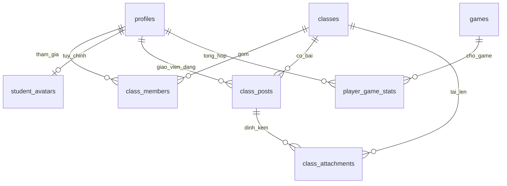

# Cấu trúc và bảo trì TIPY STEM

## Ranh giới trách nhiệm

| Vị trí                              | Trách nhiệm                                                     |
| ----------------------------------- | --------------------------------------------------------------- |
| `src/App.jsx`                       | Shell, nav, tài khoản hiện tại, cấu hình riêng cho lượt chơi    |
| `src/features/typing/`              | Thiết lập và giao diện game; logic thuần ở `src/game/engine.js` |
| `src/features/classroom/`           | Lớp học, quản lý thành viên, nhân vật và bài đăng               |
| `src/components/`                   | Dialog tài khoản, bảng kết quả, loading, âm thanh dùng chung    |
| `src/shared/Reveal.jsx`             | IntersectionObserver chạy một lần và disconnect                 |
| `src/screens/`                      | Trang chủ và trang admin                                        |
| `src/styles/`                       | CSS loader/lớp học; CSS chung ở `src/index.css`                 |
| `api/tipy.js`                       | HTTP, cookie phiên, origin, giới hạn body và phân phối action   |
| `server/backend.js`                 | Ghép các service với một Supabase client chỉ có ở server        |
| `server/modules/identity.js`        | Đăng ký/đăng nhập, HMAC PIN ngắn, phiên và kiểm tra hồ sơ       |
| `server/modules/games.js`           | Game, thống kê học sinh và kết quả giới hạn dung lượng          |
| `server/modules/game-validation.js` | Quy tắc điểm, thời gian, trạng thái và cấu hình                 |
| `server/modules/classrooms.js`      | Kiểm tra thành viên, CRUD mềm và ký URL Storage                 |
| `db/`                               | Schema PostgreSQL, migration cộng thêm, RLS và RPC transaction  |

Comment giải thích ranh giới, điều kiện an toàn hoặc lý do thiết kế. Tên hàm và cách chia module diễn tả thao tác; không thêm comment lặp lại từng dòng code.

## Mô hình dữ liệu

- `class_members` có khóa ghép `(class_id,user_id)`; tránh thành viên trùng và cho phép một học sinh tham gia nhiều lớp. Tên lớp không sao chép vào hồ sơ.
- `classes.archived_at` dùng xóa mềm/khôi phục. Các liên kết, thành viên, bài và file được giữ nguyên. `class_members.is_active` bỏ/khôi phục thành viên.
- `student_avatars` có một hàng/tài khoản; chỉ chấp nhận 12 con giáp Việt Nam và tập phụ kiện/màu cố định. API chỉ cập nhật tài khoản của phiên đăng nhập.
- Bài viết lưu text thuần, link HTTP(S); React escape nội dung. Tệp lưu trong bucket riêng, metadata ở bảng liên kết; không lưu base64 trong database.
- RPC `tipy_publish_post` kiểm tra admin, lớp, file đã có trong Storage và ghi bài + liên kết file trong một transaction.

## Quyền truy cập

| Thao tác                          | Khách | Học sinh          | Admin              |
| --------------------------------- | ----- | ----------------- | ------------------ |
| Luyện gõ thử                      | Có    | Có                | Có                 |
| Lưu kết quả, xem top              | Không | Có                | Có                 |
| Xem lớp/bài/thành viên/file       | Không | Chỉ lớp được thêm | Tất cả lớp đang mở |
| Đổi nhân vật                      | Không | Chỉ của mình      | Chỉ của mình       |
| Tạo/đổi tên/lưu trữ/khôi phục lớp | Không | Không             | Có                 |
| Thêm/bỏ thành viên, gửi/gỡ bài    | Không | Không             | Có                 |

Backend kiểm tra role từ DB và membership trước khi phục vụ dữ liệu hoặc ký URL. RLS và quyền RPC là lớp chặn độc lập; không dựa vào nút disabled ở giao diện. Không cấp quyền sửa bảng trực tiếp cho authenticated/anon. Server key không đi vào bundle.

File: tối đa 3 tệp/bài, 5 MB/tệp; PNG/JPG/WEBP/PDF/TXT/DOCX/XLSX/PPTX. Bucket private. URL tải xuống có hạn 5 phút; URL đã cấp có thể dùng tới khi hết hạn dù sau đó tài khoản bị bỏ khỏi lớp. Upload đi thẳng tới Storage qua URL có phạm vi một file; không qua giới hạn body 16 KB của API. File tải dở/chưa gắn bài không hiển thị với học sinh; cần kiểm tra định kỳ để dọn các upload admin bỏ dở nếu có.

## Tài nguyên và giới hạn

- Mã admin/lớp học/cài đặt và màn chơi tải riêng bằng React.lazy; chỉ mount màn hình đang mở; game hủy requestAnimationFrame/listener khi rời màn hình.
- Reveal chạy một lần, disconnect observer; không có listener cuộn liên tục. Tôn trọng `prefers-reduced-motion`. Hiện dần là hiệu ứng giao diện, không tự làm giảm chi phí truy vấn.
- Bài tải 20/lần qua class_posts khi phân trang hoặc sau đăng/gỡ bài, không đọc lại thành viên và Top; ảnh chỉ tải khi mở file và dùng lazy decoding. CSS `content-visibility` giúp bỏ qua render bài ngoài vùng xem.
- Danh sách lớp tối đa 200, danh sách quản lý học sinh 200, sơ đồ lớp 300. Khi trung tâm vượt các mức này, bổ sung phân trang/tìm kiếm trước khi mở rộng.
- Kết quả game vẫn một hàng tổng hợp/người/game, tối đa best+latest; tổng thời gian không mất khi thay kết quả.
- Dữ liệu khóa và quan hệ có chỉ mục phục vụ membership và feed. Bảng lớp không có polling tự động; tải lại trang để nhận phân lớp mới từ admin.

## Quy trình sửa đổi

1. Chạy `npm ci` khi cài mới. Không đưa `.env*` hoặc service key vào Git.
2. `npm run format` để định dạng; `npm run format:check` để kiểm tra.
3. `npm run build` rồi `npm test`. Test UI dùng bundle vừa build, cần giữ thứ tự này.
4. Với schema mới, chạy lần lượt `db/schema.sql`, `db/compact_results.sql`, `db/classrooms.sql`. Migration lớp đã kiểm thử chạy lặp không mất dữ liệu.
5. Test RLS, quyền endpoint, dữ liệu và UI trước khi push. Vercel cũng chạy build + test trước khi phát hành.

Chỉ xóa vĩnh viễn bản ghi/file sau một quy trình dọn có rà soát; nút xóa lớp thông thường chỉ lưu trữ.

## Trang chủ giới thiệu và kho game

`src/screens/HomePage.jsx` giới thiệu Typing, Scratch, lớp học và địa chỉ TIPY STEM Cẩm Lệ. Không mount bảng top hoặc danh sách trò chơi trên trang này.

`src/screens/GameLibrary.jsx` nằm tại `#typing`, đọc catalog game đang mở từ API; chọn Chữ rơi chuyển tới `#typing/setup`. Game chưa có client engine sẽ hiển thị trạng thái Đang chuẩn bị. Thêm metadata game trong DB và đăng ký engine/screen trong `src/game/catalog.js` khi triển khai một game mới; không cho cấu hình DB thực thi mã hoặc điều hướng tới URL tùy ý.

## Chọn thành viên theo lô

`RosterEditor.jsx` giữ lựa chọn và bộ lọc ở client; chọn checkbox không gọi API. Khi thêm/bỏ, `class_members` gửi một danh sách tối đa 200 ID trong một POST. Server kiểm tra admin, lớp và toàn bộ tài khoản rồi upsert tất cả bằng một câu lệnh; không có vòng lặp gọi mạng từng học sinh. Không cần migration database.

`class_roster` chỉ lấy ID thành viên khi mở lớp hoặc bấm làm mới, không tải bài, ảnh hoặc nhân vật. Sau POST thành công, bảng lớp và cột lớp trong bảng học sinh được cập nhật trong bộ nhớ; không gọi lại bootstrap/history/students. Không cập nhật lạc quan trước phản hồi server; lỗi giữ nguyên lựa chọn và dữ liệu cũ. Tài khoản đã khóa không được thêm; vẫn có thể bỏ khỏi lớp nếu đang là thành viên. Nút chọn tất cả chỉ tác động những hàng đang hiển thị.

## Layout, chuyển động và ảnh Scratch

`responsive.css` được import sau CSS feature và chịu trách nhiệm header/nav cùng bố cục dialog. Dialog dùng `.dialog-viewport` cố định theo vùng nhìn thấy, căn giữa bằng grid; `.modal` chỉ là panel tương đối. Không gán animation của màn hình cho `.modal`: keyframe `screen-enter` có transform sẽ phá căn giữa nếu dùng fixed/translate(-50%,-50%). Animation dialog riêng chỉ dịch panel nhẹ trong grid.

`useDialogViewport(open)` lắng nghe resize/scroll của `visualViewport` trong lúc hộp mở, cập nhật CSS variables qua requestAnimationFrame và gỡ listener khi đóng. CSS có fallback vh/dvh và safe-area; form 16 px tránh zoom tự động trên điện thoại, panel cuộn nội bộ khi bàn phím hoặc màn hình ngang làm giảm chiều cao.

`home-motion.css` áp dụng fade/stagger một lần cho tiêu đề, ảnh, CTA; tắt khi prefers-reduced-motion. Ba ảnh Scratch do chủ website cung cấp được lưu tên ổn định trong `src/assets`, khai báo kích thước để giữ tỷ lệ và hạn chế nhảy bố cục. Tổng dung lượng khoảng 53 KB. Vite tạo đường dẫn asset có hash; script standalone nhúng ảnh thành data URL để bản HTML vẫn mở offline.

`bootstrapReady` từ callback khởi tạo tài khoản cho phép HomePage bắt đầu stagger sau khi loading đóng. Trang chủ không cần đăng nhập: cả thành công và lỗi bootstrap đều kết thúc loading và mở hiệu ứng. Không chạy animation phía sau overlay rồi để người dùng bỏ lỡ nó.

## Thiết kế lớp học và nhân vật trong Tài khoản

`ClassroomPage` có lưới ô vuông: mỗi ô là một thành viên thật, không tạo ô học sinh giả. Desktop đặt `ClassAchievements` bên phải, màn hình nhỏ xếp xuống dưới. Thành tích được dựng từ các thành viên đã qua kiểm tra quyền của lớp; điểm lấy best_play của Chữ rơi, thời gian cộng dồn tất cả game. Top tối đa 10, không có truy vấn xếp hạng toàn trung tâm. Endpoint leaderboard chung đã gỡ, kết quả best/latest không bị xóa.

`AvatarPicker` chỉ mount trong tab Nhân vật của Account. GET avatar và POST avatar_save luôn dùng user_id từ session, không nhận userId đích từ client và không yêu cầu đã vào lớp. Save cập nhật override cá nhân ở App để ô học sinh/Top đang mở đổi ngay, không tải lại cả lớp.

`PostComposer` chỉ mount cho admin và API vẫn kiểm tra admin. Layout form + preview riêng: preview là state client, link chỉ HTTP(S), text do React escape. Ảnh preview dùng object URL và revoke khi thay file/rời component; chỉ nút Đăng mới gọi upload/post. Học sinh chỉ thấy bài đã gửi. Không cần migration database cho thay đổi này.

Lưới học sinh và form giáo viên dùng key khác nhau (`roster-...`, `composer-...`) khi đổi lớp. Không tái sử dụng cùng key cho các phần tử anh em khác loại: React có thể giữ DOM mồ côi của lớp trước. Các refresh bất đồng bộ cũng đối chiếu latestClassId trước khi ghi vào màn hình hiện tại.

## Hiệu năng lớp học

- Dùng danh sách lớp từ bootstrap, không gọi classes lần nữa khi vào lớp. Bootstrap đọc game/lớp song song sau xác thực.
- Cache chi tiết lớp trong bộ nhớ App tối đa 15 giây theo user/class; xóa khi đổi tài khoản, bỏ cache sau thay đổi bài hoặc phân trang. Nút Làm mới lớp học đọc lại thành viên, Top và bài; dữ liệu không được cache công khai trên CDN.
- API frontend gộp các GET giống nhau đang chờ, không giữ response lâu dài; POST xóa danh sách yêu cầu dùng chung. Server vẫn xác thực phiên và quyền lớp ở mỗi yêu cầu.
- Truy vấn thành viên chỉ lấy điểm từ JSON best_play, không truyền toàn bộ snapshot game từ database. Top giữ cách tính điểm/thời gian và tối đa 10 người.
- Ảnh mới lớn hơn 150 KB có bản xem trước WebP cạnh dài tối đa 960 px nếu trình duyệt hỗ trợ và bản mới nhỏ hơn. File gốc không đổi; thumbnail private lưu cạnh file có marker .previewable. trong storage_path, không cần migration schema. Ảnh cũ hoặc browser không hỗ trợ vẫn dùng bản gốc.
- URL gốc/preview chỉ cấp sau kiểm tra quyền, hạn 5 phút; UI dùng lại tối đa 4 phút. Nếu preview lỗi, UI dùng lại ảnh gốc. Khi dọn file phải dọn cả đường dẫn gốc và đường dẫn gốc + .webp cho file có marker .previewable.
- Upload tối đa 3 file song song; mỗi file tải gốc rồi preview. Chờ mọi upload kết thúc, chỉ publish nếu tất cả thành công. File upload bỏ dở vẫn cần quy trình dọn đã nêu ở trên.
- Admin chỉ tải lịch sử khi mở tab Kết quả, tái sử dụng danh sách lớp bootstrap.
- npm test build bundle riêng .test-dist với inlineDynamicImports cho JSDOM; dist production giữ code splitting. scripts/standalone.mjs cũng build bundle một file riêng để không phá bản HTML offline.

Kiểm tra browser production: npm run build rồi node scripts/check-performance.mjs (cần Google Chrome). Script dùng asset production thật và chuyển đổi ảnh bằng canvas thật, nhưng giả lập API/Storage; không đo độ trễ Vercel/Supabase thực tế.

Vercel Functions được đặt tại Singapore (sin1) để gần Supabase và người dùng Việt Nam; region mặc định iad1 làm mỗi truy vấn phải đi xa. Chỉ một region, không thay đổi schema hoặc quyền truy cập.
